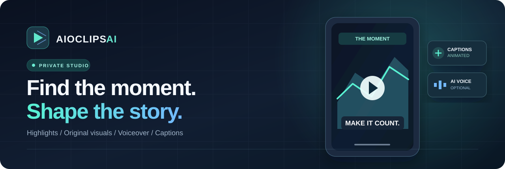
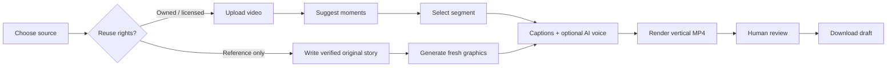

<div align="center">
  

  <br />

  **A private, rights-aware studio for turning authorized footage and independently written stories into vertical video.**

  <a href="https://github.com/AION-2000/AIOClips-AI/actions/workflows/backend-tests.yml"></a>
  
  
  
  

  <br /><br />

  <a href="https://aion-2000.github.io/AIOClips-AI/"><strong>🌐 LIVE PREVIEW</strong></a> · <a href="https://github.com/AION-2000/AIOClips-AI/actions/workflows/batch-original-story.yml"><strong>☁️ CLOUD RENDERER</strong></a>

  <br />

  [**Get started**](#quick-start) · [**Explore capabilities**](#capabilities) · [**Architecture**](docs/ARCHITECTURE.md) · [**Roadmap**](docs/ROADMAP.md) · [**Security**](SECURITY.md)

</div>

---

## Live links

| Experience | Link | Current status |
| :--- | :--- | :--- |
| **Website preview** | **[Open AIOClips AI ↗](https://aion-2000.github.io/AIOClips-AI/)** | Public GitHub Pages UI prototype |
| **Cloud video rendering** | **[GitHub Actions batch renderer ↗](https://github.com/AION-2000/AIOClips-AI/actions/workflows/batch-original-story.yml)** | Working original-story batch render; requires authorized GitHub workflow access |
| **Private FastAPI studio** | Not publicly deployed | Runs locally or on a separately provisioned backend |

> **Note:** The live website is a frontend preview only. It is **not yet connected** to the cloud renderer, so visitors cannot upload and generate video directly from that page.

## Built for moments, not timelines

AIOClips AI is a personal production workspace for discovering compelling segments in footage **you can legally reuse** and exporting them as polished 9:16 drafts. When a third-party video is only a reference, a separate **Original Story** workflow generates new graphics from independently written material—without downloading or reusing that video's frames or audio.

> [!IMPORTANT]
> **Development alpha, not a production SaaS or copyright-clearing tool.** The GitHub Pages [preview](https://aion-2000.github.io/AIOClips-AI/) is a **static UI prototype**. It is not connected to the FFmpeg backend. The functional API and private studio must be run locally or deployed separately.

### Two creative paths

| | **Highlight Studio** | **Original Story Studio** |
| :--- | :--- | :--- |
| **Starting point** | Original or licensed video file | Independently verified facts and newly written story beats |
| **Output** | Vertical clip based on authorized footage | Newly generated geometric visuals |
| **Creative layers** | Headline, animated captions, optional voiceover | Original title, animated captions, optional voiceover |
| **Source permissions** | Footage and audio reuse rights required | Reference link is never imported or downloaded |
| **Review** | Human rights and content review | Human facts, originality and publication review |

## Capabilities

| Capability | State | What it actually does |
| :--- | :---: | :--- |
| Private, mobile-friendly studio | ✅ Implemented | Browser UI served by the backend with bearer-token API access |
| Local video upload | ✅ Implemented | Validates playable media, duration and file size |
| Moment suggestions | ✅ Heuristic | Uses audio energy; scene-cut fallback for silent footage |
| Short-form rendering | ✅ Implemented | FFmpeg 1080 × 1920 output with blurred backdrop and headline |
| Animated subtitles | ✅ Implemented | Karaoke-style ASS captions with estimated pacing |
| AI narration | 🔑 Optional | Speech API integration; needs a separately configured API key and credits |
| Original Story mode | ✅ Implemented | Generates graphics from your verified, independently written text |
| YouTube URL recognition | ✅ Implemented | Validates links only; **does not download video** |
| Automatic goal/event understanding | ◻ Planned | No vision-based semantic event recognition yet |
| Automatic link-to-video pipeline | ◻ Planned | No unattended research or source import |
| Frame-accurate caption alignment | ◻ Planned | Captions currently use estimated timing |
| YouTube OAuth publishing | ◻ Planned | No direct upload or automatic publishing |
| Public deployment | ◻ Pending | Requires a provisioned video-processing service |

<details>
<summary><strong>What the app currently looks like</strong></summary>

The private studio frontend is in [`backend/app/studio.html`](backend/app/studio.html) and [`backend/app/studio.js`](backend/app/studio.js). The public [GitHub Pages preview](https://aion-2000.github.io/AIOClips-AI/) is a separate static concept, **not a live demonstration of rendering or AI features**.

</details>

## Workflow



**No automatic social publishing occurs.** Video source rights, script originality, factual correctness, and platform eligibility remain the publisher's responsibility.

## Quick start

### Requirements

- Docker, or Python 3.11 with FFmpeg/FFprobe installed
- A private `STUDIO_ACCESS_TOKEN` for the API
- Optional: `OPENAI_API_KEY` for AI narration (**never expose it in client code**)

### Option A — Docker

From the repository root:

```bash
docker build -t aioclips-studio .

docker run --rm \
  --name aioclips \
  -p 127.0.0.1:8000:8000 \
  -e STUDIO_ACCESS_TOKEN="replace-with-a-strong-random-token" \
  -v aioclips-data:/data \
  aioclips-studio
```

Open **http://localhost:8000** and enter the same studio token in the private login field. If you want AI voice, provide `OPENAI_API_KEY` as a **server-side** environment variable through a secure deployment mechanism; otherwise leave narration empty.

### Option B — Python development

```bash
python -m venv .venv
source .venv/bin/activate
python -m pip install -r backend/requirements.txt

export STUDIO_ACCESS_TOKEN="replace-with-a-strong-random-token"
cd backend
uvicorn app.server:app --reload
```

For Windows PowerShell, activate with `.venv\Scripts\Activate.ps1`, set the token using `$env:STUDIO_ACCESS_TOKEN="..."`, and ensure `ffmpeg` and `ffprobe` are on your PATH.

Visit **http://127.0.0.1:8000**. Developer API docs are available at **http://127.0.0.1:8000/docs**.

> [!NOTE]
> To use the **real** studio on a phone outside your computer, deploy the Docker service behind HTTPS with persistent storage and authentication. The repository includes [`render.yaml`](render.yaml) as an example, but deployment is not yet active. Video rendering requires compute resources and may incur hosting charges.

## Project layout

```text
AIOClips-AI/
├── assets/brand/             # Custom GitHub visual identity
├── backend/
│   ├── app/
│   │   ├── server.py         # FastAPI, authentication and render jobs
│   │   ├── studio.html/.js   # Mobile-friendly private editor
│   │   ├── clip_studio.py    # Licensed-footage workflow
│   │   ├── original_story.py # New visuals, no reference-footage reuse
│   │   ├── match_clips.py    # Audio-energy detection and FFmpeg export
│   │   ├── highlights.py     # Scene-cut candidates
│   │   ├── captions.py       # Animated ASS subtitles
│   │   ├── voice.py          # Optional AI speech
│   │   └── approval.py       # Review and publication eligibility rules
│   └── tests/                # Python tests and render smoke tests
├── docs/                     # Architecture, setup and product roadmap
├── .github/workflows/        # Backend tests and Pages preview
├── Dockerfile                # Non-root processing container
└── render.yaml               # Optional Render hosting blueprint
```

Read the [architecture documentation](docs/ARCHITECTURE.md) for boundaries, data flow and known production gaps.

## Engineering quality

Run tests locally:

```bash
python -m pip install -r backend/requirements.txt
cd backend
python -m pytest -q
```

GitHub Actions runs the backend test suite, including synthetic FFmpeg video-render checks. Passing tests validates the checked behaviors; it **does not** certify footage rights, public deployment, or end-to-end external AI availability.

## Responsible use

A watermark, crop, angle change, voiceover or caption track **does not** make unlicensed footage yours. AIOClips intentionally separates authorized footage edits from wholly original visual stories. Content ID claims, copyright strikes and platform monetization decisions cannot be guaranteed away.

Review [`SECURITY.md`](SECURITY.md) before exposing the service to the internet. Current limitations include in-memory jobs, local storage and a shared private token; production hosting needs stronger user/session management, quotas, observability and job persistence.

## Documentation

| Resource | Why it matters |
| :--- | :--- |
| [Architecture](docs/ARCHITECTURE.md) | Components, trust boundaries and real request flows |
| [Roadmap](docs/ROADMAP.md) | Prioritized delivery plan with acceptance criteria |
| [Deployment guide](docs/DEPLOYMENT.md) | Local development and hosting requirements |
| [Contributing](CONTRIBUTING.md) | Contribution and quality conventions |
| [Security](SECURITY.md) | Risk disclosure and deployment hardening |
| [Match clipping notes](docs/MATCH_CLIPS.md) | Audio-scene heuristics and authorized sources |

---

<div align="center">
  <sub><strong>AIOClips AI</strong> · Designed for original storytelling and responsible media workflows.</sub>
</div>
