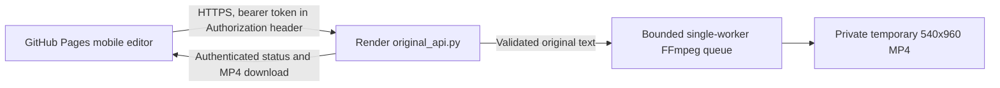
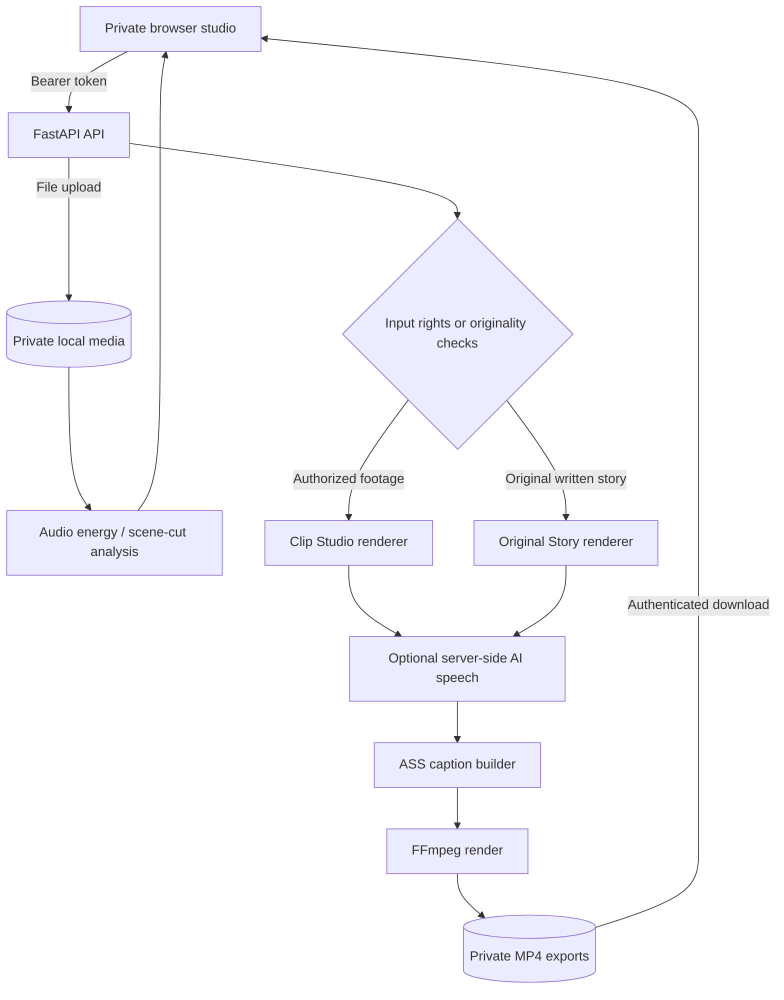
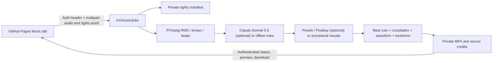

# System architecture

> **Status: development alpha.** This document describes the implemented code paths and explicitly identifies work still required for a multi-user production deployment.

## Boundaries

AIOClips has four distinct surfaces:

1. **GitHub Pages mobile studio** (`index.html`) — public static HTML/JS, sends authorized original-story API requests directly to Render over HTTPS; passphrase stays in tab memory and is never committed or persisted.
2. **Hosted original-story and licensed-footage FastAPI API** (`backend/app/original_api.py`) — Render Free Docker, owner-token auth, one FFmpeg worker, time-limited in-memory jobs, private temporary footage/MP4 files and bearer-protected downloads.
3. **Legacy private footage studio** (`backend/app/server.py`, `studio.html`, `studio.js`) — separately runnable local upload/highlight/clip API, not exposed by the public Render deployment.
4. **FFmpeg processing library** — original graphics, heuristic footage analysis, animated captions and optional speech synthesis.

## Hosted original-story media flow (implemented)

This graphic-story branch does not fetch any video frames or external audio. **The hosted API now also accepts explicitly authorized uploaded footage** with a small-file quota, uses the existing audio-energy / scene-cut heuristic to propose highlights, and runs `make_review_clip` for a selected 540×960 MP4 export. This does not import or download videos from social-media URLs. See [authorized footage](AUTHORIZED_FOOTAGE_WORKFLOW.md). A background janitor deletes completed outputs after the configured TTL. Free-tier restarts can erase all job metadata and media. The Render service reports live; **physical Android end-to-end acceptance remains pending**.

## Media flow

### Footage-based flow

- `POST /v1/uploads` accepts a multipart video file, writes it to a local `uploads` directory and probes its duration. Limit: **700 MiB** and **four hours**.
- `POST /v1/moments` ranks suggested windows by audio RMS energy. If there is no audio track, it falls back to a scene-transition heuristic.
- A suggestion is **not** a detected goal, semantic understanding of events, or verification of video claims.
- `POST /v1/renders` checks the source rights declaration, user-selected timestamp range and original caption fields, then submits an FFmpeg job.
- A successful render exposes `GET /v1/exports/{job_id}` to authenticated clients.

### Original Story flow

- `POST /v1/original-stories` accepts a title, **1–8 independently written beats**, optional narration script, and confirmations that underlying facts and originality have been reviewed.
- An optional YouTube reference URL is syntax-validated and **never downloaded, summarized, or used as a video source**.
- `original_story.py` creates new, abstract geometric video frames with a headline and story beats.
- Captions are estimated from script length. If configured, server-side AI narration creates a distinct audio track.
- This does not automatically verify copyright or legally certify the output.

## Component map

| Component | Responsibility | Current limitation |
| --- | --- | --- |
| `original_api.py` | Hosted authenticated original-story and rights-declared footage jobs, CORS, rate limits, cleanup | Single owner, ephemeral jobs, free-tier restarts |
| `server.py` | Separate local footage upload/highlight/render API | Shared token, in-memory job table |
| `match_links.py` | Canonicalize YouTube IDs | Does not fetch video information |
| `url_safety.py` | Allowlisted URL preflight | No SSRF-safe fetcher implemented |
| `highlights.py` | Scene-cut suggestions | Not semantically aware |
| `match_clips.py` | Energy ranking, vertical FFmpeg video | Not a goal detector |
| `clip_studio.py` | Authorized media workflow | Rights declaration cannot independently prove licensing |
| `original_story.py` | Original graphic-story rendering | Not image/video generative AI |
| `voice.py` | Optional external speech synthesis | Needs key, credits, service availability |
| `captions.py` | Animated ASS text tracks | Pacing estimated, not forced-aligned |
| `approval.py` | Pure review-state policy | Not yet persisted/connected to upload UI |

## Music to Video (additive route)

The hosted `backend/app/original_api.py` also mounts `backend/app/music/api.py` at `/v1/music`, using the **same server-side owner bearer token, CORS policy and single FFmpeg executor**. Existing story and footage endpoints are unchanged.

The implementation lives in `backend/app/music/`: `audio_analyzer.py`, `theme_planner.py`, `visual_fetcher.py`, `beat_editor.py`, `renderer.py`, `job_manifest.py`, `music_provider.py`, and `api.py`. Jobs are **single owner only**, with 24-hour scheduled deletion, but Render Free spin-down/restarts can delete output earlier. A preview is delivered to the phone only when a real MP4 exists. The deployed GitHub Pages static HTML contains **no API keys or bearer tokens**. Video is composed at low working resolution and upscaled to the chosen final preset to limit memory.

**Explicitly not supported:** AI music generation without verified commercial rights, auto-transcribing lyrics on small Free instances, arbitrary social source downloading, serverless private music input via public GitHub Actions, automatic publishing. See [Music to Video guide](MUSIC_TO_VIDEO.md).

## Security decisions

- Private endpoints use a server-side `STUDIO_ACCESS_TOKEN` and constant-time comparison.
- Python executes external FFmpeg binaries using argument arrays, not shell interpolation.
- Video writes and downloads use generated identifiers rather than user-provided paths.
- Docker image runs FFmpeg as a non-root user.
- Third-party reference URLs are treated as metadata, not permission to download media.
- Uploaded files are stored locally; production deployment still needs malware/media sandboxing, rate limits, storage cleanup, audit logs and robust resource quotas.

## Operational gaps before public launch

1. Durable queue (such as a worker backed by an appropriate datastore) replacing `ThreadPoolExecutor` and in-process `JOBS`.
2. Object storage with per-owner access policy, media retention and secure deletion.
3. User authentication and session lifecycle; revoke the single shared token.
4. Container CPU/memory limits, upload quotas, antivirus/content inspection, metrics and alerts.
5. Precise speech/caption alignment and failure recovery.
6. Explicit rights and factual review workflows, with immutable evidence and provenance.
7. End-to-end browser tests against a deployed service.
8. A separate authorized social-platform publishing integration, if later required.

Do not represent a green CI badge as verification of any of the above.
